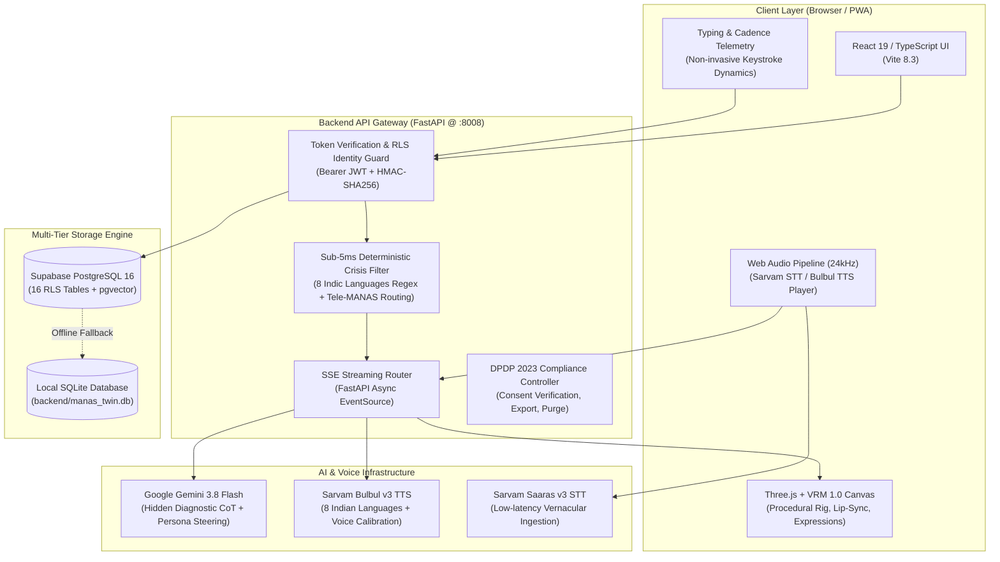

# MANAS: AI Digital Mental Twin & Multilingual 3D Companion

> **Mindful Adaptive Neurological Assistance System**  
> *A culturally-native, privacy-first 3D AI Digital Mental Twin and emotional wellness companion engineered for India's diverse linguistic landscape.*

<div align="center">

[](LICENSE)
[](https://python.org)
[](https://react.dev)
[](https://www.typescriptlang.org)
[](https://fastapi.tiangolo.com)
[](https://threejs.org)
[](https://ai.google.dev)
[](https://sarvam.ai)
[](https://supabase.com)
[](#6-privacy-center--dpdp-act-2023-compliance)
[](#-critical-non-clinical-disclaimer--crisis-protocol)

</div>

---

## 🚨 Critical Non-Clinical Disclaimer & Crisis Protocol

> [!CAUTION]
> **MANAS IS NOT A MEDICAL DIAGNOSIS SYSTEM, HEALTHCARE PROVIDER, OR LICENSED THERAPIST.**  
> MANAS is strictly a non-clinical emotional-wellness companion, self-reflection tool, and psychoeducational platform. It does **NOT** provide clinical diagnoses, medical interventions, clinical certainty, medication prescriptions, or guaranteed psychiatric outcomes.
>
> **If you or someone you know is experiencing acute emotional crisis, self-harm ideation, or severe distress:**
> - 🇮🇳 **Tele-MANAS (National Mental Health Helpline)**: Call **`14416`** or **`1800-891-4416`** (Toll-Free, 24x7, Multilingual)
> - 🚨 **National Emergency Services**: Dial **`112`**
> - 📞 **KIRAN Helpline**: Dial **`1800-599-0019`**
> - 🏥 **NIMHANS Helpline**: Dial **`080-46110007`**
> - 🧒 **Childline**: Dial **`1098`**

---

## 📑 Table of Contents

- [Executive Overview & Vision](#-executive-overview--vision)
- [Key Innovations & Core Capabilities](#-key-innovations--core-capabilities)
  - [1. Real-Time 3D Rigged WebGL Humanoid VRM Avatar](#1-real-time-3d-rigged-webgl-humanoid-vrm-avatar)
  - [2. 8 Indian Languages with Acoustically Segregated Speech](#2-8-indian-languages-with-acoustically-segregated-speech)
  - [3. Ultrafast Streaming LLM Orchestration](#3-ultrafast-streaming-llm-orchestration)
  - [4. Longitudinal Digital Mental Twin Engine](#4-longitudinal-digital-mental-twin-engine)
  - [5. Gamified OCEAN Personality & Intervention Efficacy](#5-gamified-ocean-personality--intervention-efficacy)
  - [6. Privacy Center & DPDP Act 2023 Compliance](#6-privacy-center--dpdp-act-2023-compliance)
  - [7. Supabase Authentication & Multi-Tier Resilience](#7-supabase-authentication--multi-tier-resilience)
- [System Architecture](#-system-architecture)
- [Technology Stack Breakdown](#-technology-stack-breakdown)
- [Quick Start: How to Run Locally](#-quick-start-how-to-run-locally)
- [Automated Verification & Testing](#-automated-verification--testing)
- [Repository File Map](#-repository-file-map)
- [Academic Defense, Documentation & Slides](#-academic-defense-documentation--slides)
- [License](#-license)

---

## 🌟 Executive Overview & Vision

Over **150 million Indians** require mental health support, yet **80% lack access** due to social stigma, acute specialist shortages, and a linguistic divide where typical digital wellness apps are exclusively English-centric or robotic chatbots.

**MANAS** (*Mindful Adaptive Neurological Assistance System*) addresses this challenge by providing:
1. **Culturally Native Dialogue**: High-empathy conversation across **8 Indian languages** (Hindi, Tamil, Telugu, Kannada, Malayalam, Bengali, Marathi, and Indian English) with code-mixing/Tanglish comprehension.
2. **Embodied 3D Interaction**: A friendly, expressive 3D humanoid avatar rendered entirely in WebGL with viseme-synchronized lipsync, lifelike blinking, and natural breathing.
3. **Personalized Mental Twin**: Continuous tracking of longitudinal equilibrium, self-reported sleep/workload strain, and typing cadence telemetry—without clinical overstepping.
4. **Uncompromising Privacy**: Built from the ground up for India's **Digital Personal Data Protection (DPDP) Act 2023**, with single-click cryptographic data erasure and zero image retention.

---

## 💡 Key Innovations & Core Capabilities

### 1. Real-Time 3D Rigged WebGL Humanoid VRM Avatar
- **VRM 1.0 Humanoid Specification**: Rigged female and male avatar meshes (`girl.vrm`, `boy.vrm`) loaded directly in the browser using Three.js and `@pixiv/three-vrm`.
- **Spectral Formant Viseme Lip-Sync**: 60 FPS real-time audio FFT spectral analysis categorizing incoming audio into 5 vowel morph targets (`aa`, `ih`, `ou`, `ee`, `oh`) with smooth exponential falloff.
- **Micro-Kinetic Animation Engine**: Procedural idle breathing cycles, natural blinking with random saccades, head tilting during active listening, and responsive emotional expressions (happy, calm, reflective, concerned).
- **Procedural Photo Avatar Matching**: Zero-storage MediaPipe FaceMesh & Gemini visual feature extraction matching hair texture, eye position, and skin tones into stylized 3D avatars without ever saving user selfies to disk.

### 2. 8 Indian Languages with Acoustically Segregated Speech
- **Comprehensive Multilingual Support**: English (`en-IN`), Hindi (`hi-IN`), Tamil (`ta-IN`), Telugu (`te-IN`), Kannada (`kn-IN`), Malayalam (`ml-IN`), Bengali (`bn-IN`), and Marathi (`mr-IN`).
- **Acoustic Voice Calibration**: Powered by **Sarvam AI Bulbul v3**, providing specialized companion personas (e.g. *Janani*, *Priya*, *Kavya*, *Aarav*, *Rohan*, *Aditya*) with tuned fundamental frequency (F0) pitch and natural speaking pace.
- **Enterprise Speech-to-Text (STT)**: Voice recording with **Sarvam Saaras v3** over secure server-side proxies, featuring Voice Activity Detection (VAD) and auto-silence cutoff.
- **Shared Low-Latency AudioContext**: 24kHz Web Audio pipeline with parallel chunk prefetching, gapless sentence scheduling, and automatic ducking during user speech.

### 3. Ultrafast Streaming LLM Orchestration
- **Gemini 3.8 Flash Streaming**: Server-Sent Events (SSE) streaming delivering the first response token in under **750 ms**.
- **Dual-Tier Dynamic Prompting**:
  - Hidden diagnostic chain-of-thought ($\le 60$ tokens) assessing emotional valence, cognitive distortion patterns, and coping readiness.
  - Concrete detail reflection guaranteeing $\ge 1$ specific user-mentioned element is acknowledged per turn.
- **Anti-Repetition Semantic Safeguard**: Strict Cosine Similarity checks ($< 0.60$) ensuring fresh, un-canned companion responses.
- **Deterministic Crisis Pre-Screening**: Sub-5ms deterministic pattern triage that catches crisis triggers in any of the 8 languages *before* invoking generative LLMs.

### 4. Longitudinal Digital Mental Twin Engine
- **7-Day & 14-Day Equilibrium Drift**: Calculates running mood baselines, variance, and trend direction from verified user entries.
- **Workload & Strain Signals**: Correlates self-reported sleep quality, academic/work pressure, and somatic energy levels into non-diagnostic trend indicators.
- **Keystroke Telemetry**: Real-time typing speed, pause frequency, and correction ratio compared strictly against the individual's own baseline to observe cognitive fatigue.
- **Honest Empty States**: Zero artificial baseline hallucinations; transparently displays `"Not enough data yet to establish baseline"` until sufficient genuine check-ins occur.

### 5. Gamified OCEAN Personality & Intervention Efficacy
- **Scenario-Based Big Five Discovery**: Interactive dilemma scenarios mapping Openness, Conscientiousness, Extraversion, Agreeableness, and Neuroticism without clinical labeling.
- **"What Works For Me" Empirical Tracker**: Objective efficacy scores for 6 self-regulation techniques:
  - 4-7-8 Rhythmic Breathing (with animated circle and companion breath sync)
  - 5-4-3-2-1 Sensory Grounding
  - Cognitive Reframing
  - Reflective Journaling
  - Binaural Soundscapes
  - Mindful Walking Pauses

### 6. Privacy Center & DPDP Act 2023 Compliance
- **10 Granular Consents**: Independent, revocable toggles for mood tracking, chat memory, biometric typing telemetry, voice recording, and longitudinal analytics.
- **Instant JSON Export**: One-click download of all stored memories, journals, check-ins, and safety plans (`POST /api/privacy/export`).
- **Cryptographic Cascading Purge**: Complete, permanent erasure of user records, database entries, and vector embeddings (`POST /api/privacy/delete-account`).
- **Cryptographic Protection**: AES-256-GCM encrypted sensitive fields with HMAC-SHA256 blind indexing.

### 7. Supabase Authentication & Multi-Tier Resilience
- **Flexible Sign-In**: Phone OTP authentication, verified Email/Password, or immediate **"Skip for now · Continue as Guest"** anonymous session flow.
- **16 Row-Level Security (RLS) Tables**: Strict PostgreSQL schema isolating user sessions, conversations, messages, wellness baselines, memories, and privacy preferences.
- **Resilient Fallback Engine**: Transparent local SQLite fallback (`backend/manas_twin.db`) if cloud network latency or downtime occurs.

---

## 🏗️ System Architecture



---

## 💻 Technology Stack Breakdown

| Layer | Technology | Usage in MANAS |
| :--- | :--- | :--- |
| **Frontend Framework** | **React 19 / 18 + Vite 8.3** | Component hierarchy, reactive companion state, routing, and hot reloading |
| **Language & Typings** | **TypeScript 5.9** | Strict static type validation across API payloads, 3D meshes, and audio states |
| **3D Avatar & Graphics** | **Three.js (r186) + `@pixiv/three-vrm`** | Humanoid VRM loading, bone manipulation, blendshape morph targets, studio lights |
| **Motion & Visuals** | **GSAP + Lenis Smooth Scroll** | Fluid metaball ink trails, landing curtain reveals, and organic micro-interactions |
| **Backend Framework** | **FastAPI (Python 3.10+)** | High-throughput asynchronous endpoints, SSE streaming, and validation schemas |
| **ASGI Web Server** | **Uvicorn** | Asynchronous server implementation serving API routes on port 8008 |
| **Primary LLM** | **Google Gemini 3.8 Flash** | Streaming empathetic dialogue, hidden diagnostic reasoning, and dynamic summaries |
| **Indic Speech Synthesis** | **Sarvam AI Bulbul v3** | High-fidelity natural voice generation for 8 Indian languages with custom pitches |
| **Indic Speech Recognition** | **Sarvam AI Saaras v3** | Vernacular speech-to-text with auto-punctuation and silence detection |
| **Cloud Database & Auth** | **Supabase (PostgreSQL 16)** | Row Level Security (RLS) tables, phone OTP verification, email auth, triggers |
| **Local Persistence** | **SQLite 3 + SQLAlchemy** | Zero-configuration offline persistence for development and local testing |
| **Security & Privacy** | **DPDP Act 2023 Guidelines** | AES-256-GCM data encryption, HMAC-SHA256 blind indices, cascading purge |

---

## 🚀 Quick Start: How to Run Locally

### Prerequisites
- **Python 3.10+** (Tested on Python 3.10, 3.11, 3.12, and 3.14)
- **Node.js 18+** and **npm**
- Modern WebGL2-compatible browser (Chrome, Edge, Firefox, Brave)

### 1. Clone the Repository
```bash
git clone https://github.com/Sriram-J-CS/MANAS.git
cd MANAS
```

### 2. Configure Environment Variables
Copy the example template and fill in your API credentials:
```bash
cp .env.example .env
```
Key keys to configure in `.env`:
```ini
ENVIRONMENT=development
JWT_SECRET_KEY=your-32-char-secure-jwt-secret
EXPOSE_DEV_OTP=1
DATABASE_URL=sqlite:///./backend/manas_twin.db
LLM_PROVIDER=gemini
GEMINI_API_KEY=your-gemini-api-key
SARVAM_API_KEY=your-sarvam-ai-key  # Optional: For native Indian voice TTS/STT
```

### 3. Launch the Backend Server
```bash
# Install backend dependencies (if needed)
pip install -r backend/requirements.txt  # Or: pip install fastapi uvicorn sqlalchemy pydantic python-dotenv google-genai httpx

# Start FastAPI backend on port 8008
python -m uvicorn backend.app.main:app --host 127.0.0.1 --port 8008 --reload
```
*API is live at [http://127.0.0.1:8008](http://127.0.0.1:8008) · Interactive Swagger Docs: [http://127.0.0.1:8008/docs](http://127.0.0.1:8008/docs)*

### 4. Launch the Frontend Application
In a separate terminal:
```bash
cd frontend
npm install
npm run dev
```
*Web Application is live at [http://localhost:5173](http://localhost:5173)*

---

## 🧪 Automated Verification & Testing

MANAS comes with a comprehensive automated test suite covering authentication, crisis triage, voice latencies, and end-to-end integration:

```bash
# 1. Run all Pytest integration, auth, and pipeline tests (52+ tests)
python -m pytest tests/ backend/tests/

# 2. Run live crisis safety triage validation (11 multi-language crisis cases)
python tests/test_crisis.py

# 3. Run voice & tone acoustic frequency benchmarking
python tests/test_part_c_tones.py

# 4. Verify frontend TypeScript compilation
npm --prefix frontend run build
```

---

## 📁 Repository File Map

```
MANAS/
├── .github/                     # GitHub Actions CI/CD workflows
├── backend/
│   ├── app/
│   │   ├── auth/                # JWT verification, OTP logic, and session guards
│   │   ├── routers/             # FastAPI routes (chat, voice, twin, privacy, mood, memory)
│   │   ├── safety/              # Deterministic multi-language crisis interceptor
│   │   ├── services/            # Gemini streaming, Sarvam voice gateway, twin engine
│   │   └── main.py              # Application entrypoint and middleware assembly
│   ├── tests/                   # Backend unit and integration test fixtures
│   └── requirements.txt         # Backend Python dependencies
├── frontend/
│   ├── public/
│   │   ├── avatar/              # 3D VRM 1.0 humanoid models (boy.vrm, girl.vrm)
│   │   ├── audio/               # Multi-language onboarding audio assets (8 languages)
│   │   └── models/              # MediaPipe WASM and landmark detection assets
│   ├── src/
│   │   ├── components/
│   │   │   ├── avatar/          # Three.js VRM canvas, lip-sync, and 2D fallback
│   │   │   ├── chat/            # Streaming chat history drawer, auto-save toasts
│   │   │   ├── twin/            # Digital Mental Twin metrics and wellness charts
│   │   │   ├── privacy/         # DPDP 2023 Consent Center and data export modal
│   │   │   └── voice/           # Voice debug HUD and mic visualizer
│   │   ├── lib/
│   │   │   ├── avatar/          # VRM 1.0 lip-sync solver and MediaPipe pipeline
│   │   │   ├── audio/           # Shared 24kHz AudioContext and sound scheduler
│   │   │   ├── supabase.ts      # Resilient Supabase client with guest fallback
│   │   │   └── voice/           # Sarvam Bulbul and Saaras speech gateways
│   │   ├── App.tsx              # Root application router and layout
│   │   └── types.ts             # Complete TypeScript data model definitions
├── supabase/
│   └── migrations/              # SQL schemas for 16 RLS tables and user triggers
├── tests/                       # Modular test suite (Parts A-F, crisis triage)
├── ARCHITECTURE.md              # Detailed subsystem architectural reference
├── SECURITY.md                  # Cryptographic identity and security policies
├── PRIVACY.md                   # DPDP Act 2023 compliance specifications
├── AI_SAFETY.md                 # Multi-tier clinical safety & crisis guardrails
├── TESTING.md                   # Complete test inventory and benchmark results
├── DEPLOYMENT.md                # Cloud Run, Docker, and Kubernetes deployment guide
├── technology stack.txt         # Exhaustive specification of every tool, library, and file
├── pptexpl.txt                  # Slide-by-slide PPT presentation guide and defense script
└── README.md                    # Project overview (this document)
```

---

## 📚 Academic Defense, Documentation & Slides

For in-depth reviews, evaluation matrices, and conference presentations, refer to:
- 📖 [**MANAS Comprehensive Technical Report**](MANAS_COMPREHENSIVE_PROJECT_REPORT.md): 40+ page master defense dossier with mathematical equations and clinical references.
- 🎙️ [**Slide-by-Slide PPT Presentation Guide**](pptexpl.txt): Complete slide deck structure with speaker scripts and comparison tables.
- ⚙️ [**Technology Stack Reference**](technology%20stack.txt): Exhaustive mapping of all 20+ technologies and directory references.
- 🛡️ [**AI Safety & Crisis Specification**](AI_SAFETY.md): 6-stage guardrail pipeline and emergency routing logic.
- 🔒 [**Privacy Architecture**](PRIVACY.md): DPDP Act 2023 Section 6 and Section 12 implementation proofs.

---

## 📄 License

This project is licensed under the **MIT License** — see the [LICENSE](LICENSE) file for details.

---

<div align="center">

**MANAS — Empowering emotional resilience through culturally-native, privacy-respecting AI.**  
*Developed with ❤️ for India and the global mental wellness community.*

</div>
